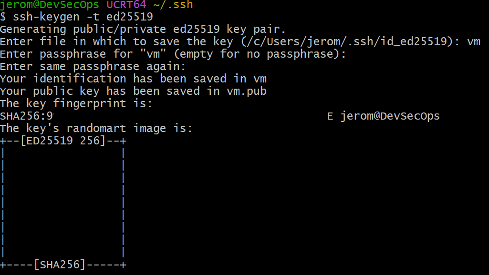
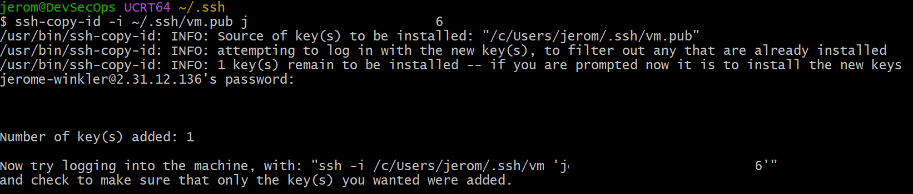
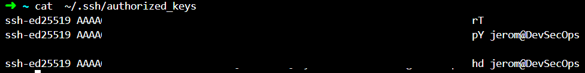
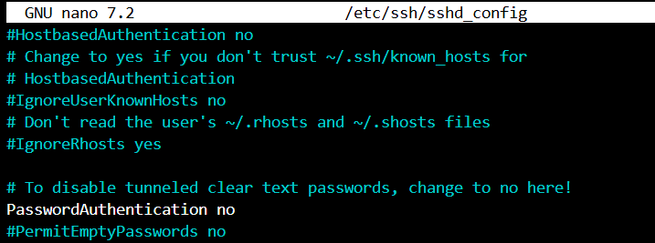
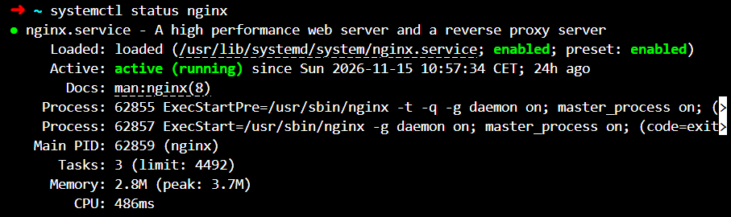
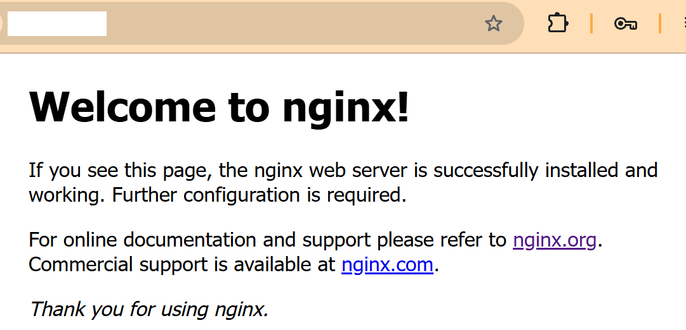
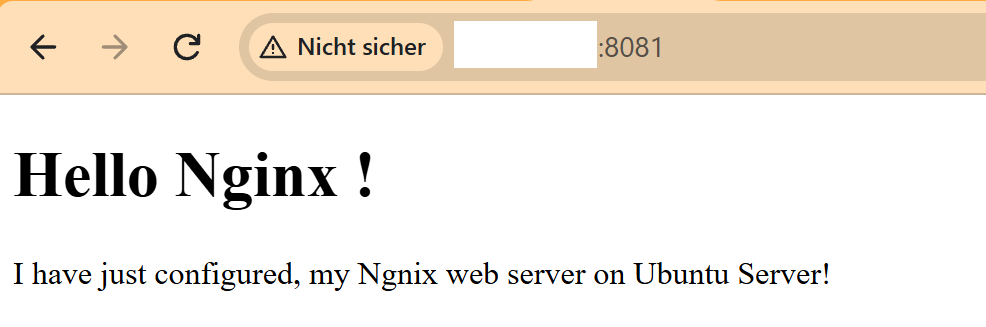
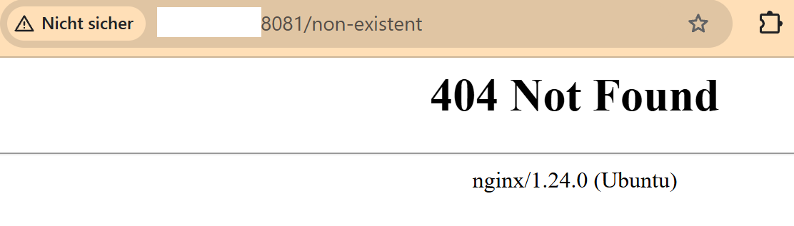
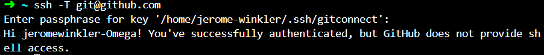
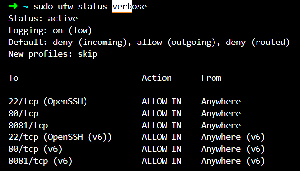

# V-Server setup steps

[← Back to README](../README.md)

Perform the steps **in this order**. Replace all placeholders with angle brackets.


---

## 1. Clone the repository on PC

Go to the directory where you want to clone your repository.

```
git clone git@github.com:jeromewinkler-Omega/dev-blog-template.git
```

Create a separate branch for changes:

```
git checkout -b add-project-v-server-setup
```

---

## 2. Generate an SSH key pair

**Windows (PowerShell):**

```
ssh-keygen -t ed25519 -f ~\.ssh\v-server_id_ed25519
#or
ssh-keygen -t ed25519
#enter file in which to save the key
#set passphrase
```


| Option | Meaning |
|:--|:--|
| `-t ed25519` | Key type (modern, secure, short) |
| `-f` | Path and filename |
| `-C` | Comment, helps with later matching |

Assign a **strong passphrase** and save it in a password manager.

Check if both files exist:

```
ls ~\.ssh
# v-server_id_ed25519 -> Private Key (remains local!)
# v-server_id_ed25519.pub -> Public Key (goes on the server)
```

---

## 3. First connection to the server

```
ssh <User>@<server-Ip>
```

- The first time, the server's **fingerprint** will be displayed. Confirm with `yes`; it will then be saved in `~/.ssh/known_hosts`.

- Next, enter the initial password provided by your hosting provider.

- **Important:** Linux usernames are case-sensitive.

Log out with `exit`.

---

## 4. Store the public key on the servern


**Windows (PowerShell)** 

```
PS C:\Users\jerom> type C:\Users\jerom\.ssh\v-server_id_ed25519.pub | ssh <User>@<server-Ip> "cat >> .ssh/authorized_keys"
```


| command-typ | meaning |
|:--|:--|
| `type` | outputs the file contents (like `cat` in Linux) |
| `\|` | pipe: passes the output to the next command |
| `>>` | appends without overwriting existing keys (`>` would overwrite!) |


**git:**

```
ssh-copy-id -i ~/.ssh/v-server_id_ed25519.pub <User>@<server-Ip>
```



**Login test via key-pair.** her you need to use the private Key, not the `.pub`-file:

```
ssh -i ~/.ssh/v-server_id_ed25519 <User>@<server-Ip>
```

check which keys are authorized:

```
ls -al ~/.ssh
cat ~/.ssh/authorized_keys
```

---

## 5. Create SSH-Config 

Create or modify the `~/.ssh/config` file on your local computer.

```
Host v-server
    HostName V-Server
    User <User>
    PreferredAuthentications publickey
    IdentityFile ~/.ssh/Key_id_ed25519
    IdentitiesOnly yes
```

from now on only following is needed:

```
ssh V-Server
```


## 6. Harden the server

Run only after the key login from step 4 works. **Keep the current session open** until the test is successful.

Check if your user has sudo 

```
sudo whoami
```

Open server configuration (`sshd_config`, **not** `ssh_config`):

```
sudo nano /etc/ssh/sshd_config
```

set following line on (`#` delete) :

```

PasswordAuthentication no

```

Save with `Ctrl + O`, exit with `Ctrl + X`.



Test, reload, and verify the configuration:

```

sudo systemctl reload ssh

```

**Verification** in a **second** terminal:

```

ssh v-server # must work

ssh -o PubkeyAuthentication=no <User>@<server-Ip> # must fail with "Permission denied"

```

---


## 7. Update the system and install Nginx

```
`sudo apt update` 
`sudo apt upgrade`
`sudo apt install nginx -y`
`systemctl status nginx`

```

 Maybe a prompt will appear regarding services with outdated libraries. Select the suggested services (e.g., `packagekit.service`, `polkit.service`, `unattended-upgrades.service`) to restart.



Open `<Server-Ip>` in your browser: The standard Nginx page will appear.


---

## 8. Create your own website on port 8081

Create the directory and HTML file:

```

sudo mkdir -p /var/www/alternatives

sudo nano /var/www/alternatives/alternate-index.html
```

```
<!doctype html>
<html>
<head>
    <meta charset="utf-8">
    <title>Hello Nginx!</title>
</head>
<body>
    <h1>Hello Nginx!</h1>
    <p>I have just configured my Nginx web server on Ubuntu Server!</p>
</body>
</html>
```

create server block:

```
sudo nano /etc/nginx/sites-available/alternatives
```

```
server {
    listen 8081;
    listen [::]:8081;

    root /var/www/alternatives;
    index alternate-index.html;

    location / {
        try_files $uri $uri/ =404;
    }
}
```


- listen:     Port  
- root:       Directory from which service is served 
- index:      Default file when accessing `/` 
- try_files:  Serve file or directory, otherwise return `404` 

test, reload:

```
sudo nginx -t
sudo systemctl restart nginx
```

**checking:**

| URL | Erwartet |
|:--|:--|
| `http://<server-ip>` | Nginx-standard page |
| `http://<server-ip>:8081` | „Hello Nginx!" |
| `http://<server-ip>:8081/non-existent` | `404 Not Found` |




---

## 9 Set config global user info 

set the same global user info `name & email` as you have on your local device

```
git config --global user.name "User"
git config --global user.email "userr@gmail.com"
```


## 10. Server mit GitHub verbinden

create own key pair on **server**:

```
ssh-keygen -t ed25519 
#directory:
~/.ssh/gitconnect
cat ~/.ssh/gitconnect.pub
```


Upload the generated public key to GitHub:

**Repository -> Settings -> Deploy keys -> Add deploy key** .
create config on server `~/.ssh/config`:

```
Host github.com
    HostName github.com
    User git
    IdentityFile ~/.ssh/gitconnect
    IdentitiesOnly yes
```

```
ssh -T git@github.com
```

Expected: `Hi <github-user>/<repo>! You've successfully authenticated...`




---

## 11 Clone git repository 

go to directory `cd ~/projrcts/` and create new directory 

```
mkdir -p ~/projects 
cd ~/projects
```

Set the permissions to root
```
sudo chown -R <User>:<User> ~/projects
``` 

clone the repository:

```
git clone git@github.com:<GitHubName>/<RepoName>.git
```

check download and status of the repository

```
ls -al
cd dev-blog-template
git status
```


## 12 Set Firewall

Configure UFW firewall to allow only required ports

Enable the Uncomplicated Firewall (UFW) on the V-Server and restrict
incoming traffic to the services that actually need to be reachable.

Default policy:
- deny all incoming connections
- allow all outgoing connections (apt, git pull, etc.)

Allowed ports:
- 22/tcp (OpenSSH): remote administration, opened first to avoid lockout
- 80/tcp (HTTP): Nginx default site, later required for Let's Encrypt
- 8081/tcp: Nginx test server block, temporary, remove after testing

Verification:
- SSH login tested in a second session after enabling UFW
- Rules checked with `sudo ufw status verbose`
- Websites reachable on ports 80 and 8081




Setup complete. 

---

[Troubleshooting](02_troubleshooting.md)